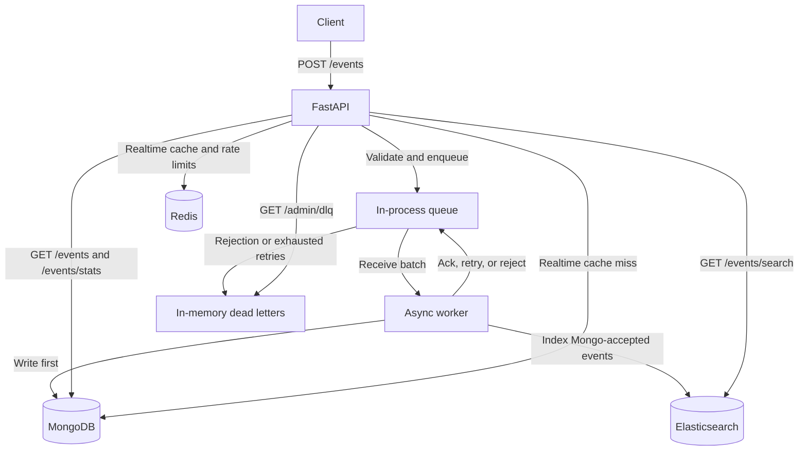

# Architecture

Starly accepts web events, processes them asynchronously, and exposes filtered reads, aggregations, and full-text search. FastAPI and the worker run in the same process. MongoDB stores events, Elasticsearch serves search, and Redis caches realtime summaries and holds rate-limit counters. Setup and endpoint examples are in the [README](README.md).

This document describes the implementation in `src/app`. Proposed changes are listed separately; there are no measured throughput, latency, or scaling guarantees here.

## Data flow



`POST /events` returns 202 after enqueueing, not after persistence. A returned event ID therefore does not guarantee that either store contains the event. Reads may lag acceptance; Elasticsearch also has refresh delay after indexing.

`main.py` creates the clients, ensures Mongo indexes and the Elasticsearch index, and starts worker tasks. The defaults are one worker task and batches of up to ten events. API and worker tasks share an event loop and process memory; they cannot be deployed independently with the current queue.

## Validation and metadata

The API rejects unknown top-level event fields and unknown query parameters on the event read routes. Clients cannot supply `event_id` or `ingested_at` through ingestion. The domain model generates a UUIDv7 ID, normalizes event types, converts timestamps to UTC (treating naive values as UTC), and rejects timestamps more than five minutes ahead by default.

Metadata is intentionally schema-free: arbitrary keys, including misspellings, are allowed. There is no application-defined key allowlist or type schema. The default cap is 16 KiB using the model's JSON serialization size check. BSON compatibility adds storage constraints: integers must fit signed 64-bit values and keys cannot contain NUL, including in nested objects. Dotted and `$`-prefixed keys and NUL in string values remain allowed. Invalid metadata is rejected rather than rewritten or truncated.

The same model validates queued bodies. Mongo also BSON-encodes each complete document before submitting a bulk write, returning permanent per-event errors for encoding failures. Filtering invalid documents preserves the mapping between Mongo bulk error indexes and event IDs, so valid neighbors can proceed.

These checks are not a total request-size or memory limit. Other string fields have no explicit length caps, and metadata has no explicit key-count or nesting-depth cap. `source_url` is a string, not a validated URL, and is not fetched by the application.

## Queue and worker semantics

`queue/protocol.py` defines `send`, `receive_batch`, `ack`, `nack`, and `reject`. `SimulatedQueue` implements them with ready, delayed, in-flight, and dead-letter collections in memory.

| Operation | Current behavior |
|---|---|
| `send` | Admit unless ready + delayed + in-flight count reaches `QUEUE_MAX_DEPTH` (default 10,000). Full queues produce HTTP 503 with `Retry-After: 1`. |
| `receive_batch` | Move up to ten ready messages in flight and increment their receive counts. |
| `ack` | Remove an in-flight message. |
| `nack` | Schedule exponential backoff plus jitter, or dead-letter at `MAX_RECEIVE_COUNT` (default five receives). |
| `reject` | Dead-letter immediately for invalid input or permanent storage failure. |

This supports bounded retry/redelivery while the process runs, not durable delivery. There is no visibility timeout, receipt handle, or automatic recovery of a stranded in-flight message. The worker normally settles messages explicitly and nacks unsettled messages in a `finally` block. Ordering is not guaranteed.

A restart loses ready, delayed, in-flight, and dead-letter contents. Some accepted events may never be persisted; others may have been processed multiple times through retries before the restart.

### Processing and duplicate IDs

The worker validates each body, requires an event ID, sets `ingested_at`, and writes Mongo first. Only events without Mongo errors go to Elasticsearch. A message is acknowledged after both writes succeed.

Within one batch, matching payloads with the same event ID share a write to each store and are settled together. The first valid payload wins; a conflicting payload with that ID is rejected. The comparison excludes worker-generated `ingested_at`.

Mongo replacement upserts and Elasticsearch document IDs prevent duplicate records for the same event ID. This is not exactly-once processing or immutable storage: retries rewrite documents and regenerate `ingested_at`, and conflicting payloads in separate batches can replace earlier content. Repeating an HTTP POST generates a new ID and creates another event; there is no client idempotency-key support.

### Dead letters

The DLQ retains at most `DLQ_MAX_DEPTH` entries (default 1,000). When full, it evicts the oldest entry and logs its ID, receive count, and error, not a recoverable copy of its body. Dead letters do not consume active queue capacity, so a failing pipeline can keep admitting events while older failures are discarded.

`GET /admin/dlq` returns all retained bodies and errors, oldest first. There is no replay or deletion endpoint. An operator can export entries and resubmit corrected bodies through ingestion, which assigns new event IDs. Evicted entries and entries lost on restart cannot be recovered from the queue.

Active and dead-letter limits bound retained message counts, not bytes. Payload sizes, error text, request parsing, inspection responses, batches, and client buffers still affect process memory.

## Storage choices and consistency

### MongoDB: event storage and aggregations

`storage/mongo.py` uses `_id = event_id` and unordered replacement upserts. Mongo serves filtered lists, time-bucketed stats, and realtime summaries. It is the source of truth for persisted events; this does not make queue acceptance durable.

Lists sort by `(timestamp descending, _id descending)`. The four application-created indexes are:

```text
(event_type, timestamp descending, _id descending)
(user_id, timestamp descending, _id descending)
(source_url, timestamp descending, _id descending)
(timestamp descending, _id descending)
```

The indexes support common equality-filter and time-sort patterns. They do not guarantee optimal plans for every combination of filters. The ID breaks timestamp ties, but offset pagination is not a stable snapshot when new events arrive. Defaults cap list size at 500 and offset at 10,000; skipping deep offsets still costs work.

There are no metadata indexes or indexes for every filter combination, avoiding their write and storage cost. Stats aggregate matching documents on demand; an omitted time range can scan the full collection and return many buckets. Realtime summaries filter on event timestamp with a lower bound only, so accepted future-skewed events also count. No rollups or event-retention policy are implemented.

### Elasticsearch: a derived search index

`storage/es.py` uses the event ID as the document ID. The mapping defines keyword filters, a date field, analyzed `source_url.text`, and `search_text`. Metadata string values, including nested strings, are concatenated into `search_text`; metadata keys and numeric values are not added to that field. The full metadata remains in `_source`.

`dynamic: false` prevents arbitrary metadata keys from creating mapped fields, avoiding per-key mapping growth and dynamic metadata type conflicts. It does not validate metadata semantics or guarantee every document can be indexed. There are no per-field metadata filters or metadata numeric/date ranges. The default text analyzer applies; changing extraction or analysis requires a reindex to update existing data.

Search combines `multi_match` with exact/range filters. Returned hits are capped at 100 by default, while `track_total_hits=True` requests an exact matching count, which can add work for broad queries. Index creation sets one shard and zero replicas. Existing indexes are left unchanged, not migrated at startup. Search visibility follows Elasticsearch refresh behavior; the application does not refresh after each write.

Mongo-first writes prevent indexing an event whose Mongo write reported failure, but there is no transaction spanning the stores. If Elasticsearch fails after Mongo succeeds, retry repeats both writes. Permanent failures, exhausted retries, or process loss can leave Mongo events missing from search indefinitely. There is no automatic reconciliation or backfill service. Search has no Mongo fallback because a regex query would have different matching and ranking semantics.

### Redis: cache and shared counters

`cache/realtime.py` implements cache-aside summaries for the API's allowed windows: 60, 300, and 900 seconds. On a miss it aggregates Mongo, adds `computed_at`, and writes a versioned Redis key with a default 30-second TTL. Writes do not invalidate snapshots, allowing reuse during continuous ingestion. Freshness also depends on pipeline lag and the event timestamps, not just TTL.

A per-window `asyncio.Lock` serializes cache fills within one process and rechecks Redis inside the lock. With successful cache writes, waiting requests reuse the snapshot. It is not a distributed lock: multiple replicas can compute the same window concurrently.

Redis errors and corrupt entries are treated as misses; failed cache writes are logged and the computed result is returned. There is no local fallback snapshot. During Redis failure, waiting requests can each recompute in sequence, so the lock limits local concurrency rather than total aggregation work. TTL and the window allowlist do not impose a global aggregation-rate bound during failures, eviction, or concurrent fills across replicas. Socket timeouts bound individual Redis operations, not total endpoint latency. Mongo compute errors still propagate.

The fixed-window rate limiter uses Redis transactions and separate read/write counters per client IP. Defaults are 120 writes and 600 reads per 60-second window; Compose raises the write limit to 5,000 for local seeding. GET and POST requests under `/events` are limited; health and admin routes are not. Replicas using the same Redis and compatible configuration share counters, but fixed windows permit boundary bursts. Redis errors fail open, and eviction or restart can reset quotas. Client identity depends on the deployment's proxy configuration; IP limits are not authentication or tenant isolation.

## Failures and lifecycle

After startup, ingestion does not call Mongo or Elasticsearch directly. It can continue returning 202 during their outages while queue capacity remains, but workers consume the retry budget and may move events to the DLQ before recovery.

| Failure | Effect |
|---|---|
| Mongo unavailable | Worker retries; list/stats reads can return 503 `storage_unavailable`. Realtime can serve a readable cached snapshot until expiry, then requires Mongo. |
| Elasticsearch unavailable | Mongo writes can succeed while indexing retries; search transport failures return 503 `search_unavailable`. Catch-up is limited by retries and volatile retention. |
| Redis unavailable | Rate limiting fails open; realtime computes from Mongo for each miss. Readiness reports degradation despite those fallback paths. |
| Queue full | Ingestion returns 503; reads do not depend on queue capacity. |
| Process exit | All unpersisted queue contents and the DLQ are lost. Persisted Mongo and Elasticsearch data remain subject to their own deployment durability. |

The HTTP handlers map Mongo `ConnectionFailure` and Elasticsearch `TransportError` to the dependency-specific 503 responses. Other exceptions are not universally classified as outages; unhandled exceptions produce a generic 500 and a server-side log.

For worker bulk results, BSON encoding failures and non-retryable Mongo item codes are permanent; unknown Mongo item codes default to permanent. Elasticsearch item 4xx errors except 429 are permanent; 429 and server errors retry. Unexpected batch exceptions are logged and unsettled messages are nacked. If settlement itself fails or a worker task exits, its callback logs the crash, but there is no automatic task restart.

On shutdown, worker cancellation waits for the current shielded batch to finish before closing clients. It does not drain ready or delayed messages, and forced termination can interrupt processing.

`/health` only confirms the HTTP handler responds. `/health/ready` pings all three stores with per-check timeouts and returns 503 if any fails. It does not check worker-task liveness, queue backlog, or indexing completeness. Startup requires Mongo index setup and Elasticsearch index setup to succeed; runtime degradation is not the same as starting without those dependencies. The container health check uses `/health`, not readiness.

## Security and operational costs

This is a local demonstration deployment, not a hardened public service:

- There is no authentication, authorization, or tenant isolation. Event reads and `/admin/dlq` expose bodies to anyone who can reach the API; the admin route has no separate network restriction in application code.
- Compose publishes the API on port 8000 without a loopback-only binding. Store ports bind to loopback, but Elasticsearch security is disabled and the supplied service connections have no configured authentication or TLS. Public deployment requires an explicit access-control and transport-security design.
- Metadata validation and the Elasticsearch mapping are storage safeguards, not abuse prevention. Unbounded non-metadata strings, unrestricted stats ranges, exact search counts, and unpaginated DLQ inspection can consume resources. Rate limiting fails open and does not cover admin routes.
- The app container runs non-root with a read-only filesystem and no-new-privileges in Compose. These controls do not protect API data or replace access control.
- MongoDB, Elasticsearch, and Redis add separate resource, upgrade, backup, and monitoring requirements. Mongo has four secondary indexes to maintain; Elasticsearch duplicates event data and indexes text. Compose gives Mongo and Elasticsearch data volumes, but no backup procedure or redundant topology. Redis uses a 64 MiB `allkeys-lru` budget and disables scheduled snapshots, so cache pressure can evict rate-limit counters too.
- Logs include request IDs for HTTP work, but request context is not carried in queue messages. Worker errors and DLQ output can contain sensitive details. There are no exported application metrics or end-to-end traces; event timestamp to `ingested_at` also includes client delay, so it is not a direct measurement of queue lag.

Capacity and bottleneck order need measurement with representative payloads, query ranges, and failure scenarios. Increasing worker concurrency still shares the process and stores; adding API replicas creates independent volatile queues. Neither is evidence of a particular throughput multiplier.

## Proposed changes, not implemented

1. **Durable queue and separate workers.** SQS is a candidate, not a drop-in adapter. The protocol provides a useful boundary, but an integration needs message serialization and size handling, receipt handles, visibility-timeout renewal, delivery-count mapping, and partial batch-result handling. Immediate rejection via DLQ send followed by source delete is not atomic. Redrive, admission/backpressure, IAM, deployment, and DLQ inspection also need redesign; the current admin route depends on `SimulatedQueue`. Durable delivery still requires duplicate-safe processing, monitoring, and retention policies.
2. **Access control before public deployment.** Add authentication, authorization, tenant scoping, protected admin access, TLS, payload limits, and data-retention rules.
3. **Recovery and observability.** Track acceptance-to-processing lag, backlog, retries, DLQ evictions, and search divergence; add worker liveness checks and a Mongo-to-search reconciliation path.
4. **Query changes driven by measurements.** Cursor pagination can avoid deep offsets. Rollups or incremental counters may reduce aggregation work, but introduce consistency and recovery costs. Distributed cache coordination or a local outage fallback would need explicit failure semantics, not just a longer TTL.
5. **Deployment-specific storage planning.** Choose replicas, backups, retention, and any sharding from measured needs. Splitting cache and quota storage can isolate eviction effects. None of these changes is provided by the current single-node Compose stack.
