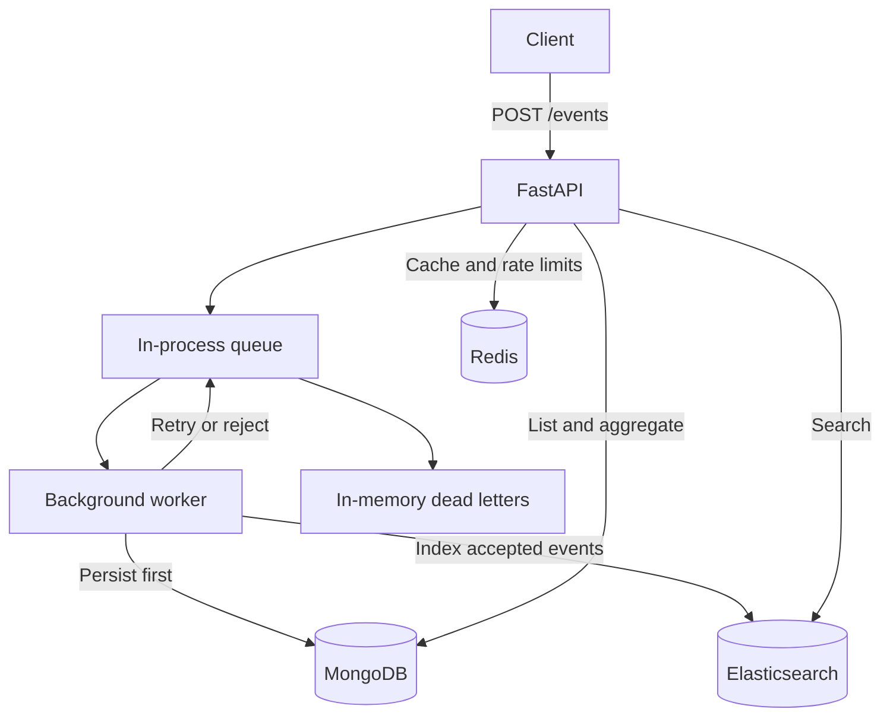

# Starly

An event-processing backend built with FastAPI. Submit web events, retrieve and aggregate them from MongoDB, search their metadata through Elasticsearch, and read cached activity summaries from Redis.

The project explores asynchronous processing and failure handling: queue backpressure, per-event bulk-write results, duplicate delivery, retries, dead letters, and cache degradation. The API and worker share a process and an in-memory queue. This is a local demonstration, not a durable distributed service; no throughput benchmark is published.



See [ARCHITECTURE.md](ARCHITECTURE.md) for processing semantics, storage choices, failure behavior, and proposed changes.

## Run locally

### Prerequisites

- Docker Engine or Docker Desktop, running with Docker Compose v2 and Linux container support.
- [uv](https://docs.astral.sh/uv/getting-started/installation/) for local Python dependencies, tests, and the seed script. The checkout pins Python 3.14 in `.python-version`; uv can install it. The package declares Python 3.12 or newer.
- GNU Make for the shortcuts below, and curl for the examples. Run commands from the repository root in a POSIX-compatible shell, such as WSL on Windows.
- Ports 8000, 27017, 9200, and 6379 available locally.

Compose configures container memory limits totaling about 2.4 GiB, including a 512 MiB Elasticsearch JVM heap. These are configuration limits, not measured usage or a minimum host requirement; leave additional memory for Docker, builds, and the host.

```sh
uv sync --frozen
make up
curl --fail http://localhost:8000/health/ready
```

`make up` builds the app and waits for container health checks. The separate readiness call checks MongoDB, Elasticsearch, and Redis. Startup requires MongoDB and Elasticsearch index setup to succeed. If startup fails, inspect `docker compose ps` and `docker compose logs app elasticsearch`.

Open the [interactive API docs](http://localhost:8000/docs) to inspect schemas and try requests.

### Try the pipeline

Submit an event with distinctive metadata. The historical timestamp below is valid but will not appear in the recent-window summary; use a current UTC timestamp to exercise that endpoint with this event.

```sh
curl -i -X POST http://localhost:8000/events \
  -H 'Content-Type: application/json' \
  -d '{
    "event_type": "pageview",
    "timestamp": "2026-07-10T12:00:00Z",
    "user_id": "trainer_red_0021",
    "source_url": "https://www.pokemart.example/",
    "metadata": {"browser": "Safari", "campaign": "portfolio-demo"}
  }'
```

A successful response is `202 {"event_id": "...", "status": "queued"}`. It confirms queue admission, not persistence. Once the worker has processed the event, use these reads; search visibility may lag indexing until Elasticsearch refreshes.

```sh
curl 'http://localhost:8000/events?user_id=trainer_red_0021&limit=3'
curl 'http://localhost:8000/events/stats?bucket=day&type=pageview'
curl 'http://localhost:8000/events/search?q=portfolio-demo'
```

For a larger dataset, the seed script sends 1,000 synthetic PokéMart events through the HTTP API. It mixes historical and recent timestamps for bucketed and realtime stats.

```sh
make seed
curl 'http://localhost:8000/events?type=conversion&limit=3'
curl 'http://localhost:8000/events/search?q=squirtle'
curl 'http://localhost:8000/events/stats/realtime?window=300'

# Optional count and concurrency overrides; these are script flags.
make seed ARGS="--count 2000 --concurrency 32"
```

The script reports accepted events, not confirmed processing completion. Repeated runs add new events. Compose raises the write rate limit from the application default of 120 to 5,000 requests per minute for seeding.

```sh
make down                 # stop the stack; keep stored data volumes
make down-reset-volumes   # delete MongoDB and Elasticsearch volumes too
```

Stopping the app loses its queued messages and dead letters, even when database volumes are preserved.

## API reference

These limits are application defaults; configuration can override many of them. Full request and response schemas are available at `/docs`.

### Common behavior

- Errors use `{"error": {"code": "...", "message": "...", "details": ...}}` and responses include `X-Request-ID`.
- Unknown event body fields and unknown query parameters on event read routes return 422.
- Event timestamps are normalized to UTC; naive input is treated as UTC.
- Rate limits use fixed windows per client IP: 120 writes and 600 reads per 60 seconds across `/events` routes. Exceeding a limit returns 429 with `Retry-After`. Redis errors disable enforcement rather than blocking requests.
- MongoDB connection failures return 503 `storage_unavailable`; Elasticsearch transport failures return 503 `search_unavailable`. Redis cache errors fall back to MongoDB computation. Other unexpected errors can return 500.

### `POST /events`

Validate and enqueue one event. A full active queue returns 503 with `Retry-After`.

| Field | Contract |
| --- | --- |
| `event_type` | Required nonempty string; trimmed and lowercased |
| `timestamp` | Required ISO 8601 datetime; at most 300 seconds ahead by default |
| `user_id` | Required string |
| `source_url` | Required string; not validated or fetched as a URL |
| `metadata` | Optional object; defaults to `{}`; maximum 16,384 bytes under the model's JSON serialization check |

IDs are server-assigned UUIDv7 values. Clients cannot supply `event_id` or `ingested_at`. Repeating a POST creates a new event; there is no client idempotency key.

Metadata supports nested objects and arrays without a fixed application schema. Integers must fit signed 64-bit BSON values (`-9223372036854775808` through `9223372036854775807`), and keys cannot contain NUL (`\u0000`) at any nesting level. Dotted keys, `$`-prefixed keys, and NUL in string values are allowed. Incompatible metadata returns 422 before queue admission; values are not silently rewritten.

The worker validates queued input too. Invalid bodies go directly to the dead-letter queue. Storage checks each complete document for BSON encoding failures so valid events in the same batch can continue.

### Read endpoints

| Endpoint | Query parameters | Result |
| --- | --- | --- |
| `GET /events` | `type`, `user_id`, `source_url`, `from`, `to`; `limit` 1–500 (default 50); `offset` 0–10,000 | `{"events": [...]}` from MongoDB, sorted by timestamp then ID descending |
| `GET /events/stats` | Required `bucket`: `hour`, `day`, or `week`; optional `type`, `from`, `to` | `{"stats": [{"event_type": "...", "bucket_start": "...", "count": 1}]}` |
| `GET /events/search` | Required `q` (1–1,024 characters); optional `type`, `user_id`, `source_url`, `from`, `to`; `limit` 1–100 (default 50) | `{"events": [...], "total": n}`, ordered by search relevance |
| `GET /events/stats/realtime` | `window`: 60, 300, or 900 seconds (default 300) | `{"window_seconds": 300, "total": n, "counts_by_type": {...}, "computed_at": "..."}` |

Date ranges use ISO 8601 timestamps. Stats buckets are UTC; weeks start Monday. `/events/stats` does not accept `user_id` or `source_url` filters.

Search covers metadata string values and source URL tokens, not metadata keys or numeric values. `total` is the exact count of indexed matches, including above 10,000; `limit` only caps returned hits. Exact counting adds work for broad queries.

Realtime summaries aggregate MongoDB on a cache miss and store a snapshot in Redis for 30 seconds by default. `computed_at` identifies that snapshot's computation time, not the completion time of the latest submitted event. The three allowed windows bound cache-key variety. With Redis unavailable, requests compute from MongoDB without a retained fallback snapshot.

### Operations and dead letters

```sh
curl http://localhost:8000/health        # HTTP liveness
curl http://localhost:8000/health/ready  # dependency status; 503 if degraded
curl http://localhost:8000/admin/dlq     # {"entries": [...], "total": n}
```

Readiness checks stores, not worker liveness or processing progress. The admin endpoint is unauthenticated and exposes retained event bodies and errors.

The active queue retains at most 10,000 ready, delayed, and in-flight messages. The separate dead-letter queue retains the newest 1,000 failures by default. On overflow it discards the oldest failure and logs its ID, receive count, and error, but not a recoverable payload copy. Overflow does not block ingestion.

Inspect and export dead letters before eviction or restart. Corrected bodies can be resubmitted through `POST /events` with new IDs; there is no automatic replay or deletion endpoint. Evicted payloads are lost. These are message-count bounds, not byte limits on process memory.

### Validation examples

```sh
curl 'http://localhost:8000/events?event_type=pageview'       # 422: use type
curl 'http://localhost:8000/events/stats?bucket=month'        # 422: unsupported bucket
curl 'http://localhost:8000/events/stats/realtime?window=120' # 422: unsupported window
```

## Configuration

Settings are read from environment variables or `.env` at startup; there is no hot reload. See [config.py](src/app/core/config.py) for the full list. Compose supplies container hostnames for the stores.

| Variable | Default | Purpose |
| --- | --- | --- |
| `MONGO_URL` / `ES_URL` / `REDIS_URL` | Localhost URLs | Store connections |
| `QUEUE_MAX_DEPTH` | `10000` | Active admission capacity |
| `DLQ_MAX_DEPTH` | `1000` | Positive dead-letter retention cap |
| `WORKER_CONCURRENCY` / `WORKER_BATCH_SIZE` | `1` / `10` | Worker tasks and messages per batch (maximum ten) |
| `RETRY_BASE_DELAY` / `MAX_RECEIVE_COUNT` | `1.0` / `5` | Backoff base in seconds and receive-count ceiling |
| `REALTIME_CACHE_TTL` | `30` | Snapshot TTL in seconds |
| `RATE_LIMIT_WRITES_PER_WINDOW` / `RATE_LIMIT_READS_PER_WINDOW` | `120` / `600` | Per-IP request budgets |
| `RATE_LIMIT_WINDOW_SECONDS` | `60` | Fixed-window duration |
| `METADATA_MAX_BYTES` | `16384` | Serialized metadata cap |
| `TIMESTAMP_MAX_FUTURE_SKEW_SECONDS` | `300` | Allowed future timestamp skew |
| `LOG_LEVEL` | `INFO` | Application log level |

## Development and verification

After `uv sync --frozen`:

```sh
make lint                 # Ruff formatting check and lint; no changes
make test-unit            # default pytest selection; no services required
make up                   # start services before integration tests
make test-integration     # real MongoDB, Elasticsearch, and Redis
make test                 # unit and integration suites
make fmt                  # apply Ruff formatting and lint fixes
```

Without Make, use `uv run ruff format --check .`, `uv run ruff check .`, `uv run pytest`, and `uv run pytest -m integration`. Integration tests write test data to the local services; do not point them at shared or production stores.

Unit tests cover validation, API contracts, queue behavior, worker outcomes, cache handling, and rate limiting with injected dependencies. Worker tests use the real in-process queue with fake stores. Integration tests cover storage behavior, ingest-to-read/search flows, duplicate delivery, retry exhaustion, and Redis fallback. Search tests explicitly refresh the index instead of depending on refresh timing. These are correctness checks, not load or production-capacity measurements.

## Limits of the current implementation

- **Volatile acceptance.** A 202 does not mean durable storage. Restarting loses queued work and dead letters; retries can exhaust before a dependency recovers.
- **No cross-store transaction.** MongoDB can contain an event missing from search after indexing failure or process loss. There is no reconciliation service. Duplicate-safe IDs do not imply exactly-once processing.
- **Local deployment only.** There is no authentication or tenant isolation. Compose publishes port 8000 on all host interfaces, and Elasticsearch security is disabled. Do not expose this stack to an untrusted network.
- **Resource and query limits.** Three external stores add operational cost. Events have no retention policy; non-metadata strings have no explicit size caps; unrestricted stats ranges and exact search totals can be expensive.
- **Limited operational visibility.** Logs and readiness are available, but there are no exported metrics, end-to-end traces, or worker-liveness readiness checks.

See [ARCHITECTURE.md](ARCHITECTURE.md) for the reasoning behind these choices and the work needed to change them.

## Project layout

```text
src/app/
  api/        Ingestion, queries, health, admin routes, and response schemas
  queue/      Queue protocol and in-memory implementation
  worker/     Batch processing, storage outcomes, and settlement
  storage/    MongoDB repository and Elasticsearch index
  cache/      Redis-backed realtime summaries
  domain/     Event model and validation
  core/       Settings, logging, error responses, and middleware
scripts/seed.py    Synthetic events submitted through the HTTP API
tests/unit/       Isolated tests with injected dependencies
tests/integration/ Service-backed tests
```

## Project history

Starly began as a take-home exercise and is now maintained as a backend portfolio project. The original submission is preserved at the [`take-home-submission`](https://github.com/aarrico/starly/tree/take-home-submission) Git tag. That snapshot is historical context, not the specification for the current project.
